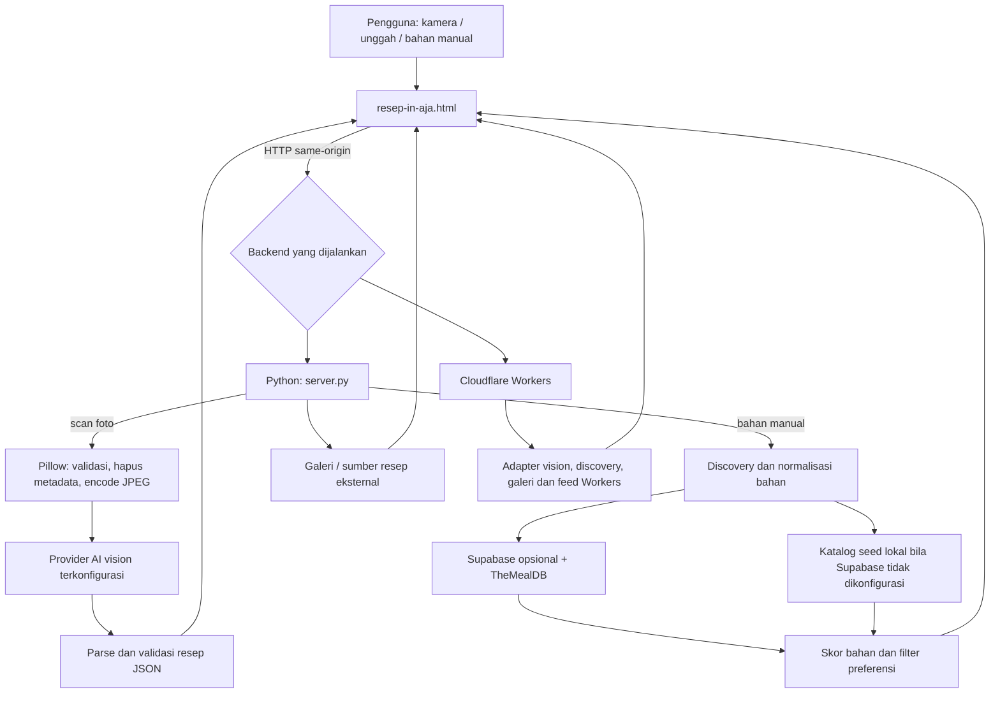

# 🍳 Resep in aja

### Isi kulkas seadanya. Ide masaknya banyak.

Purwarupa **Hackathon Sustainability** untuk menemukan ide masak dari bahan yang sudah ada: ambil foto, unggah gambar, atau tulis bahan sendiri. Aplikasi menggabungkan AI vision, pencocokan bahan deterministik, dan tautan resep dari sumber eksternal.

**[Mulai lokal](#-jalankan-lokal) · [Cara pakai](#-alur-penggunaan) · [Arsitektur](#-arsitektur) · [API](#-ringkasan-api-python) · [Deployment](#-deployment)**

> **Tanpa key AI?** Jalankan server dan coba masukan bahan manual. Katalog seed tersedia tanpa kredensial. Scan foto memerlukan key provider vision. Ini bukan aplikasi produksi siap pakai dan bukan alat penentu keamanan pangan.

## ✨ Fitur

| Fitur | Yang tersedia |
| --- | --- |
| Foto bahan | Kamera browser atau unggah beberapa gambar, pratinjau, hapus/reset, dan coba ulang |
| Resep AI | Nama hidangan, waktu/porsi, bahan terdeteksi, bahan kurang, langkah memasak, serta label provider/model |
| Masukan manual | Bahan dipisahkan koma; filter masakan, vegetarian/vegan, dan waktu maksimum |
| Pencocokan deterministik | Normalisasi alias bahan multilingual, skor kecocokan, bahan terpenuhi dan bahan kurang |
| Jelajah resep | Galeri inspirasi, pencarian resep/bahan, dan tautan ke sumber asli |
| Tautan pendamping | Pencarian tutorial YouTube dan tombol toko online; bukan pemesanan atau checkout di aplikasi |
| Pilihan runtime | Server Python lokal atau implementasi Cloudflare Workers dengan frontend yang sama |
| Pengelolaan key Windows | CLI terenkripsi DPAPI dan dashboard terminal interaktif |

## 🧭 Alur penggunaan

### 1. Buka aplikasi melalui server

Kunjungi **http://localhost:8787**, bukan membuka berkas HTML melalui `file://`. Frontend menggunakan endpoint API same-origin.

### 2. Pilih cara memasukkan bahan

**Jalur foto — tab “Bahan & resep”**

1. Klik **Buka Kamera**, izinkan akses kamera, lalu arahkan ke bahan di tempat terang; atau klik **Unggah foto**.
2. Periksa pratinjau dan jumlah gambar. Kamera dapat membuat foto utuh beserta empat crop otomatis untuk membantu membaca bahan kecil; crop ikut dihitung dalam batas gambar.
3. Klik **Cari Resep Sekarang**. Browser mengirim foto ke backend, bukan langsung ke API provider.
4. Baca resep, bahan yang terdeteksi, bahan dapur yang mungkin kurang, dan langkah memasak. Periksa kembali hasil AI sebelum digunakan.
5. Jelajahi resep alternatif atau tutorial YouTube. **Resep Baru** mengembalikan alur untuk input berikutnya; **Coba lagi** tersedia ketika scan gagal.

**Jalur manual — tanpa scan AI**

1. Pada **Atau tulis bahanmu**, isi misalnya `telur, nasi, bawang putih`.
2. Pilih filter **Masakan**, **Diet**, atau **Waktu maks** bila diperlukan, lalu klik **Cari Resep**.
3. Bandingkan skor kecocokan, bahan terpenuhi, bahan kurang, dan sumber resep. Skor adalah kecocokan bahan, bukan nilai gizi atau jaminan keamanan.
4. Jika hasil kosong, tambah bahan yang memang tersedia atau longgarkan filter. Saran fallback diberi peringatan karena tidak setara dengan kecocokan katalog.

**Sekadar mencari ide?** Gunakan galeri **Mau masak apa hari ini?** dan kolom pencarian. Kartu bertautan membuka sumber di tab baru. Tab **Resep Terbaru** perlu dibaca dengan catatan perbedaan runtime di bawah: label UI tidak berarti backend Python menyediakan feed terkini.

## 🏗️ Arsitektur



### Dua jalur yang berbeda

- **Scan foto Python** memvalidasi gambar menggunakan Pillow, memanggil provider vision, memvalidasi struktur resep, lalu memperkaya alternatif dari sumber resep. Ini bukan sekadar foto → pencocokan deterministik.
- **Masukan manual Python** menggabungkan hasil Supabase dan TheMealDB untuk dicocokkan. Jika Supabase tidak dikonfigurasi, hasil seed lokal ikut digabung. Hasil diurutkan berdasarkan skor dan status verifikasi, maksimal 10 resep.
- Ketika tidak ada kecocokan manual, respons Python memakai label `ai_fallback`, tetapi fungsi saat ini mengambil kartu terkait melalui `lookup_recipe_cards` (TheMealDB), **bukan memanggil model AI**. Jangan menafsirkan nama field itu sebagai bukti generasi AI.
- Adapter discovery terpisah dari scraping legacy. Galeri dan alternatif Python masih dapat memakai adapter sumber eksternal melalui `recipe_sources.py`.

## 🚀 Jalankan lokal

### Prasyarat

- Python **3.12 disarankan** untuk alur pengembangan ini.
- `pip` milik interpreter yang sama; gunakan `python -m pip`, bukan `pip` tanpa interpreter.
- Browser modern; kamera membutuhkan izin dan secure context, misalnya `localhost` atau HTTPS.
- Koneksi internet untuk provider AI/sumber eksternal. Pillow adalah satu-satunya dependensi runtime Python non-stdlib dalam `requirements.txt`.

Jalankan semua perintah dari root repositori. Tidak ada langkah build frontend untuk server Python.

### Windows — PowerShell

```powershell
py -3.12 -m venv .venv
.\.venv\Scripts\Activate.ps1
python -m pip install -r requirements.txt
Copy-Item .env.example .env
# Edit .env secara lokal; jangan unggah key ke repositori.
.\start.bat
```

Jika kebijakan PowerShell memblokir aktivasi, gunakan **Command Prompt** tanpa mengubah kebijakan sistem:

```bat
py -3.12 -m venv .venv
.venv\Scripts\activate.bat
python -m pip install -r requirements.txt
copy .env.example .env
start.bat
```

Jangan jalankan perintah `copy` bila `.env` sudah ada. Alternatif pengelolaan key terenkripsi Windows:

```powershell
python key_store.py set gemini
python key_store.py list
python server.py
```

`set` meminta key lewat input tersembunyi. Di terminal Windows interaktif, dashboard menyediakan `1` untuk setup key, `Ctrl+L` untuk dashboard/log, dan `Q` untuk berhenti. Perubahan lewat menu berlaku untuk permintaan berikutnya.

### macOS / Linux — Bash

```bash
python3 -m venv .venv
source .venv/bin/activate
python -m pip install -r requirements.txt
cp -n .env.example .env
# Edit .env secara lokal.
bash start.sh
```

Pada distro Linux yang memisahkan modul venv, pasang paket venv untuk versi Python Anda jika pembuatan virtualenv gagal.

### Konfigurasi minimum

Untuk mencoba **manual matching saja**, tidak perlu mengisi key. Untuk scan, isi satu provider dan model vision yang tersedia pada akun Anda, misalnya:

```dotenv
PROVIDER=gemini
GEMINI_API_KEY=isi_key_anda_di_mesin_lokal
GEMINI_MODEL=gemini-3.1-flash-lite
PORT=8787
```

> `.env.example` memuat sejumlah contoh model lama, termasuk `GEMINI_MODEL=gemini-1.5-flash`. Karena nilai environment mengalahkan default kode, perbarui atau hapus baris model lama setelah menyalin template. Nama default di tabel berikut adalah isi kode, **bukan jaminan ketersediaan model di provider**.

`start.sh` dan `start.bat` memuat `.env`; **`python server.py` sendiri tidak memuat `.env`**. Bila menjalankan Python langsung, set environment terlebih dahulu atau gunakan key store Windows. Untuk `.env` lintas platform, pakai format sederhana `NAMA=nilai`, tanpa `export` dan komentar sebaris; loader Windows bukan parser dotenv lengkap. Jangan menjalankan `start.sh` dengan `.env` dari sumber tidak tepercaya karena berkas itu di-`source` oleh Bash.

Server mencoba membuka browser otomatis; jika tidak berhasil, buka URL sendiri. Hentikan dengan `Ctrl+C` atau menu terminal Windows. Default bind adalah `127.0.0.1:8787`.

## ⚙️ Konfigurasi provider & privasi

### Default server Python

| `PROVIDER` | Environment key | Model default kode | Model override |
| --- | --- | --- | --- |
| `openai` | `OPENAI_API_KEY` | `gpt-4o-mini` | `OPENAI_MODEL` |
| `anthropic` | `ANTHROPIC_API_KEY` | `claude-3-5-sonnet-20241022` | `ANTHROPIC_MODEL` |
| `gemini` | `GEMINI_API_KEY` | `gemini-3.1-flash-lite` | `GEMINI_MODEL` |
| `xai` | `XAI_API_KEY` | `grok-4-1-fast-non-reasoning` | `XAI_MODEL` |
| `groq` | `GROQ_API_KEY` | `meta-llama/llama-4-scout-17b-16e-instruct` | `GROQ_MODEL` |
| `openrouter` | `OPENROUTER_API_KEY` | `google/gemini-2.0-flash-exp:free` | `OPENROUTER_MODEL` |
| `bigmodel` | `BIGMODEL_API_KEY` atau `ZAI_API_KEY` | `glm-4v-flash` | `BIGMODEL_MODEL` |
| `siliconflow` | `SILICONFLOW_API_KEY` | `deepseek-ai/deepseek-vl2` | `SILICONFLOW_MODEL` |

Dengan `PROVIDER=auto`, urutan pemilihan adalah OpenAI → Anthropic → Gemini → xAI → Groq → OpenRouter → BigModel → SiliconFlow, hanya untuk provider yang memiliki key. `PROVIDER` dapat memprioritaskan salah satunya. Dukungan adapter tidak menjamin model/key dapat digunakan; cek kemampuan image input, akses akun, kuota, dan ketentuan provider. README ini tidak menjanjikan harga atau kuota gratis.

### Batas data dan fallback

- Key berada di backend, bukan form pengunjung. Konfigurasi adalah **per instalasi/server**, bukan BYOK per pengguna web.
- Environment key diprioritaskan atas key store lokal. `python key_store.py remove gemini` hanya menghapus key tersimpan, tidak menghapus environment. Restart setelah perubahan environment atau CLI.
- Key store menggunakan **Windows DPAPI per akun**. Linux/macOS/hosting memakai environment secrets; jangan memindahkan `.api-keys.enc.json` sebagai mekanisme konfigurasi portabel.
- Fallback lintas provider **nonaktif secara default**. Frontend saat ini selalu mengirim `allowFallback=false`, yang mengalahkan konfigurasi global. Tidak ada sakelar persetujuan fallback di UI saat ini.
- Klien API dapat mengirim `allowFallback=true` untuk mengizinkan percobaan provider berikutnya pada kegagalan yang dapat dicoba ulang. Jika field tidak dikirim, server menggunakan `ALLOW_CROSS_PROVIDER_FALLBACK` (default `false`). Foto dapat mencapai lebih dari satu provider dalam mode ini.
- Backend Python memproses foto dalam memori dan tidak menuliskannya sebagai arsip upload. Pillow menghapus metadata dan meng-encode ulang ke JPEG. Ini **bukan jaminan retensi nol oleh provider AI**; periksa kebijakan provider sebelum mengirim foto sensitif.
- Galeri dapat memuat gambar HTTPS eksternal dan tautan sumber. Browser pengguna dapat menghubungi situs tersebut; “server lokal” tidak berarti seluruh alur tanpa jaringan.

### Discovery & konfigurasi operasional

| Variabel | Default / fungsi |
| --- | --- |
| `HOST`, `PORT` | `127.0.0.1`, `8787` |
| `ENABLE_EXTERNAL_RECIPES` | `true`; mengatur sumber eksternal pada adapter discovery, bukan sakelar offline global untuk semua galeri/alternatif |
| `RECIPE_MATCH_MIN_SCORE` | `0.45` |
| `EXTERNAL_RECIPE_TIMEOUT_SECONDS` | `8` |
| `SUPABASE_URL`, `SUPABASE_ANON_KEY` | Katalog Supabase opsional; `SUPABASE_PUBLISHABLE_KEY` tersedia sebagai alias key |
| `THEMEALDB_API_KEY` | Key TheMealDB opsional; adapter memakai `1` bila tidak diisi |
| `SCAN_RATE_LIMIT_REQUESTS`, `SCAN_RATE_LIMIT_WINDOW_SECONDS` | `5` scan per IP per `60` detik |
| `MAX_CONCURRENT_SCANS`, `SCAN_DEADLINE_SECONDS` | `2` scan bersamaan; deadline chain scan `120` detik |
| `MAX_REQUEST_THREADS` | `16` slot permintaan pada server Python |
| `PUBLIC_DEPLOYMENT`, `ALLOWED_HOSTS`, `ALLOWED_ORIGINS` | Pengamanan deployment dan pembatasan host/origin; tinjau implementasi sebelum mengekspos server |

**Supabase opsional:** buat proyek, jalankan [`supabase_schema.sql`](supabase_schema.sql) melalui SQL Editor, lalu set URL dan **anon/publishable key**, bukan `service_role`. Skema menyediakan RLS untuk pembacaan resep publik. Restart server setelah konfigurasi. Tanpa Supabase, jalur seed tetap tersedia.

## 🔌 Ringkasan API Python

Semua rute relatif terhadap origin aplikasi. Ini ringkasan implementasi `server.py`, bukan janji bahwa perilaku Workers identik.

| Metode | Endpoint | Kegunaan |
| --- | --- | --- |
| `GET` | `/`, `/index.html` | Frontend |
| `GET` | `/health`, `/ready` | Status provider, model, Pillow, Supabase, dan konfigurasi fallback |
| `POST` | `/api/scan-resep` | Multipart; field `image` dapat diulang, `allowFallback` opsional; hasil `recipe`, `provider`, `model` |
| `POST` | `/api/recipes/match` | JSON `ingredients` dan `preferences`; hasil `recipes`, `ai_results`, `fallback`, serta metadata sumber |
| `POST` | `/api/ingredients/normalize` | Normalisasi daftar `ingredients` |
| `GET` | `/api/recipes/search?q=...` | Pencarian katalog seed |
| `GET` | `/api/recipes/<id>` | Detail resep seed atau Supabase |
| `GET` | `/api/resep?q=...` | Pencarian galeri yang dipakai UI |
| `GET` | `/api/inspirasi` | Galeri inspirasi |
| `GET` | `/api/viral` | Daftar kartu statis pada Python; bukan feed popularitas real-time |

Contoh Bash/macOS/Linux (PowerShell dapat memakai `Invoke-RestMethod` dengan objek JSON setara):

```bash
curl http://localhost:8787/health

curl -X POST http://localhost:8787/api/recipes/match \
  -H 'Content-Type: application/json' \
  -d '{"ingredients":["telur","nasi","bawang putih"],"preferences":{"cuisine":"indonesian","maxTimeMinutes":30}}'

curl -X POST http://localhost:8787/api/scan-resep \
  -F 'image=@bahan.jpg' -F 'allowFallback=false'
```

**Kontrak upload Python:** maksimal 5 gambar, 4 MiB per gambar, 12 MiB total, dimensi maksimal 4096 × 4096 dan 16.000.000 piksel terdekode. Validasi backend tetap berlaku meskipun browser telah menerima file. Foto kamera beserta crop juga harus memenuhi batas ini.

**Kegagalan umum:** `400` input/gambar tidak valid (termasuk beberapa pelanggaran batas upload), `413` ukuran/dimensi terlalu besar, `429` rate limit dengan `retryAfterSeconds`, `502` kegagalan provider, `503` key belum tersedia/Pillow tidak tersedia/server sibuk, dan `504` timeout. Baca field `error`, jangan hanya kode HTTP.

`/health` dan `/ready` mengembalikan **503 ketika tidak ada key AI**, meskipun frontend dan manual matching masih bisa dipakai. Status 200 menandakan ada key terkonfigurasi, bukan bukti bahwa autentikasi provider berhasil atau model tersedia.

## 📁 Peta repositori

Berkas runtime tetap berada di root; tidak perlu memindahkan sumber untuk menjalankan aplikasi.

```text
.
├── README.md                     # Panduan utama
├── resep-in-aja.html              # UI, CSS, dan JavaScript dalam satu berkas
├── server.py                      # HTTP server, proxy vision, routing, dan enrichment
├── ingredients.py                 # Normalisasi bahan dan alias
├── recipe_discovery.py            # Adapter katalog dan pencocokan deterministik
├── seed_data.py                   # Katalog resep seed
├── recipe_sources.py              # Sumber resep/galeri dan adapter legacy
├── supabase_client.py             # Adapter REST Supabase
├── supabase_schema.sql            # Tabel, RLS, dan seed Supabase
├── key_store.py                   # CLI key store Windows DPAPI
├── console_ui.py                  # Dashboard terminal Windows
├── requirements.txt              # Dependensi runtime Python
├── .env.example                   # Template konfigurasi; tinjau model lama
├── start.bat / start.sh            # Launcher yang memuat .env
├── render.yaml                    # Blueprint deployment Python
├── test_*.py                      # Pengujian backend
├── test_frontend*.js / *.cjs       # Harness UI dan regresi browser
└── cloudflare/
    ├── README.md                  # Panduan runtime/deploy Workers
    ├── package.json               # Script dev, test, deploy
    ├── wrangler.jsonc             # Konfigurasi Workers dan assets
    ├── src/                       # Implementasi backend JavaScript
    └── test/                      # Pengujian Workers
```

## 🧪 Pengujian

Dari root, dengan virtualenv aktif:

```bash
python -m unittest discover -p 'test_*.py'
node test_frontend.js
node test_frontend_manual_match.js
node test_frontend_inspiration.js
```

Harness Node memakai stub DOM; kelulusan tidak menggantikan pengujian kamera di browser atau panggilan provider nyata. Suite backend mencakup discovery, rekomendasi, regresi, adapter provider, dan keamanan. Nama “integration” tidak otomatis berarti menggunakan key/provider live; periksa fixture/mock dalam pengujian.

Untuk Workers, Node.js dan npm diperlukan:

```bash
cd cloudflare
npm ci
npm test
```

Regresi browser tambahan memakai Playwright dan Chromium, server lokal yang berjalan, serta lingkungan dengan tampilan grafis (`headless:false`):

```bash
# Playwright harus tersedia pada resolusi modul Node, berikut browser Chromium.
node test_frontend_browser.cjs
```

`BASE_URL` dapat mengubah URL target; `PLAYWRIGHT_MODULE` dapat menunjuk path modul Playwright. Dependensi browser tidak termasuk `requirements.txt`. Pengujian browser memakai respons yang diintersep sebagai fixture, bukan bukti hasil AI live. README ini tidak menyatakan seluruh suite sudah lulus pada semua OS.

## ☁️ Deployment

- **Cloudflare Workers:** ikuti [`cloudflare/README.md`](cloudflare/README.md). Backend JavaScript dan assets dikonfigurasi lewat [`wrangler.jsonc`](cloudflare/wrangler.jsonc); frontend perlu disalin menjadi `cloudflare/public/index.html`. **Jangan jadikan root repositori sebagai direktori assets**, karena dapat berisi key dan `.env`. Gunakan secret hosting, bukan key di HTML/konfigurasi publik.
- **Render / Python:** gunakan [`render.yaml`](render.yaml) sebagai blueprint awal. Build memasang `requirements.txt`, start menjalankan `python server.py`, bind `0.0.0.0`, dan health check memakai `/health`. Tanpa key AI, health check tersebut akan menerima 503.
- **Hosting sendiri:** simpan root runtime apa adanya, pasang dependensi, set environment, dan letakkan server di belakang HTTPS reverse proxy dengan batas koneksi serta kontrol akses.

> **Production / Deployment Caution:** endpoint scan menggunakan kuota/key server dan belum memiliki autentikasi atau isolasi key per pengguna. Rate limit, slot thread, validasi host/origin, dan security headers bukan pengganti login serta pembatasan penggunaan. Jangan membuka deployment publik berbayar tanpa lapisan kontrol akses.

**Perbedaan runtime yang penting:** Python memakai Pillow untuk decode dan re-encode gambar; jangan mengasumsikan validasi Workers setara. Worker memiliki implementasi provider/config sendiri: `wrangler.jsonc` saat ini menetapkan `GEMINI_MODEL=gemini-3.5-flash-lite`, berbeda dari default Python. Worker `/api/viral` memakai feed detikFood bertanggal, sedangkan Python mengembalikan daftar statis. Periksa panduan Workers untuk batasan lengkap; label “Terbaru” di UI tidak menjamin berita real-time pada Python.

## 🛠️ Troubleshooting

| Gejala | Periksa / tindakan |
| --- | --- |
| Halaman terbuka tetapi API gagal | Akses melalui `http://localhost:8787`, bukan `file://`; pastikan server tetap berjalan |
| “Belum ada API key” / health 503 | Isi key backend, jalankan launcher yang memuat `.env`, lalu restart; `python server.py` tidak membaca `.env` |
| Key sudah diisi tetapi model gagal | Cek `/health` untuk model aktif; hapus/perbarui model lama dari `.env.example`, cek akses vision, kuota dan log server tanpa membagikan key |
| Scan ditolak karena Pillow | Jalankan `python -m pip install -r requirements.txt` pada interpreter/virtualenv server yang sama |
| Kamera tidak terbuka | Izinkan kamera; gunakan localhost/HTTPS, tutup aplikasi yang mengunci kamera, atau gunakan unggah foto |
| Foto terlalu besar | Resize/kompresi sebelum unggah; periksa jumlah gambar, ukuran total, dimensi, dan crop otomatis kamera |
| HTTP 429 / server sibuk | Tunggu sesuai `retryAfterSeconds` bila ada; jangan spam retry. Periksa batas scan lokal dan kuota provider secara terpisah |
| Provider gagal tanpa berpindah | Ini default privasi; frontend mengirim `allowFallback=false`. Jangan mengaktifkan fallback tanpa persetujuan pengiriman ke provider lain |
| Manual matching kosong | Tambah bahan nyata yang tersedia, longgarkan filter, atau tinjau ambang `RECIPE_MATCH_MIN_SCORE`; tidak semua kombinasi memiliki resep cocok |
| Galeri kosong / sumber lambat | Sumber eksternal dapat gagal atau berubah; coba kata kunci lain. Seed manual tidak berarti seluruh galeri tersedia offline |
| Port 8787 terpakai | Ubah `PORT` pada `.env` lalu jalankan ulang launcher; buka port baru secara manual |
| Key lokal tidak terbaca di hosting | DPAPI terikat akun Windows; gunakan environment secrets pada host tujuan |

## ⚠️ Batasan & penggunaan bertanggung jawab

- AI dapat salah mengenali bahan, waktu, porsi, dan langkah. Aplikasi tidak dapat memastikan kesegaran, kematangan, atau keamanan konsumsi dari foto.
- Filter diet dan inferensi alergen bergantung pada metadata/bahan. Jangan menganggap hasil sebagai jaminan bebas alergen; verifikasi label bahan dan resep asli. UI manual belum menawarkan kontrol alergen meskipun backend menerima `excludeAllergens`.
- Katalog tidak mencakup seluruh resep; skor bahan mengabaikan banyak konteks dapur. Metadata waktu yang tidak tersedia dapat menyebabkan resep tersaring saat filter waktu aktif.
- Teks peringatan/nama field fallback sebagian masih menyebut AI meskipun implementasi fallback manual Python saat ini memakai kartu eksternal. Perbedaan ini dijelaskan agar integrator tidak membuat klaim generasi yang keliru.
- TheMealDB pada adapter discovery diperlakukan sebagai metadata dan tautan sumber; jalur galeri/legacy memiliki perilaku berbeda. Jangan menyimpulkan izin redistribusi teks/gambar hanya dari kemampuan API mengembalikannya. Hormati ketentuan dan atribusi tiap sumber, termasuk adapter scraping.
- Tidak ada jaminan uptime, latensi, ketersediaan provider, harga, atau kuota. Konfigurasi model dapat usang; operator perlu memvalidasinya.
- Tidak ada klaim lisensi proyek di README ini. Pastikan status izin penggunaan sebelum mendistribusikan ulang kode atau konten pihak ketiga.

---

**Mulai dari yang ada, periksa hasilnya, lalu masak dengan aman.** 🌱
